# คู่มือการเปลี่ยนแปลง EasySpace รอบ 1 พฤศจิกายน 2569

สามเรื่องในรอบนี้

1. แก้ Google Login ที่ต้องเข้าสู่ระบบ 2 รอบ
2. หน้าเว็บผู้ใช้ภายในแบบใหม่ ทุกอย่างอยู่หน้าเดียว
3. บอท Telegram "น้องจอง" จองห้อง แก้ ยกเลิก และแจ้งเตือนในแชตเดียว

ภาพในคู่มือนี้ใช้ข้อมูลตัวอย่าง ชื่อคนและชื่อประชุมเป็นชื่อสมมติ ข้อความของบอทเป็นข้อความจริงที่ระบบตอบในการทดสอบ

---

## สิ่งที่พี่ต้องทำ 3 ขั้น (บอทจะเริ่มทำงานหลังทำครบ)

หน้าเว็บกับการแก้ Login ขึ้นระบบจริงแล้ว ไม่ต้องทำอะไร ส่วนบอทต้องตั้งค่าอีก 3 ขั้น
ผมทำขั้น 1 เองไม่ได้ เพราะระบบสิทธิ์บนเครื่องไม่อนุญาตให้ผมเขียนค่าลับลง Vercel

**ขั้น 1: ใส่ค่าลับ 4 ตัวบน Vercel แล้ว deploy ใหม่**

ค่าทั้ง 4 ตัวอยู่ในไฟล์ `.env.local` แล้ว (ผมสร้างรหัสลับให้แล้ว) ใส่ทีละตัว แต่ละคำสั่งจะถามค่า ให้คัดลอกจาก `.env.local` ไปวาง

```bash
vercel env add TGBOT_TOKEN production
```
```bash
vercel env add TGBOT_USERNAME production
```
```bash
vercel env add TGBOT_WEBHOOK_SECRET production
```
```bash
vercel env add TGBOT_WORKER_KEY production
```
```bash
vercel --prod
```

หรือใส่ผ่านหน้าเว็บ Vercel: Project → Settings → Environment Variables (เลือก Production) แล้วกด Redeploy

**ขั้น 2: ผูกบอทเข้ากับระบบ**

```bash
npm run tgbot:setup
```

สคริปต์จะเช็กก่อนว่าระบบบน Vercel มีค่าลับครบแล้ว ถ้ายังไม่ครบจะไม่ทำต่อ แล้วจะตั้ง webhook เมนูคำสั่ง และคำอธิบายบอทให้

**ขั้น 3: เปิดสมองของบอทบนเครื่อง Mac นี้**

```bash
sh bot-worker/install-launchd.sh
```

ตัวนี้จะรันตลอด เปิดเองตอน login เครื่อง และกันเครื่องหลับขณะทำงาน ดู log ได้ที่ `bot-worker/logs/worker.log`

**จากนั้นลองใช้:** เปิด Telegram ค้นหา `@EasySpaceBookingBot` กด Start แล้วพิมพ์อีเมลที่ลงทะเบียนในระบบ

---

## 1. Google Login ต้องเข้าสู่ระบบ 2 รอบ

**อาการ:** กด "เข้าสู่ระบบด้วย Google" แล้วเด้งกลับมาหน้า Login ต้องกดอีกรอบถึงเข้าได้

**สาเหตุที่เจอ (มี 3 จุด)**

| จุด | เกิดอะไรขึ้น |
|---|---|
| หน้าแรก `/` และหน้า `/login` | บัญชี Google ของสมาชิกได้สิทธิ์ชื่อ "viewer" ซึ่งระบบเดิมนับเป็นแอดมิน เลยส่งไปหน้าแอดมิน หน้าแอดมินไม่ให้เข้า เด้งไป `/login?error=forbidden` แล้วหน้านั้น**สั่งออกจากระบบ** สมาชิกจึงต้อง Login ใหม่ |
| ไม่มี middleware ต่ออายุ session | หลังผ่านไป 1 ชั่วโมง token หมดอายุ หน้าเว็บต่ออายุได้แต่บันทึกไม่ได้ พอหลายหน้าโหลดพร้อมกัน Supabase เห็นว่าใช้ token เดิมซ้ำ จึงตัด session ทิ้ง |
| ตัวจำการเข้าสู่ระบบ | ระบบเดิมนับแท็บใหม่ทุกแท็บเป็น "เปิดเบราว์เซอร์ใหม่" ถ้าเคยติ๊กไม่จำการเข้าสู่ระบบไว้ เปิดแท็บใหม่ก็โดนออก |

**สิ่งที่แก้**

| ไฟล์ | เปลี่ยนอะไร |
|---|---|
| `src/middleware.ts` (ใหม่) | ต่ออายุ session และบันทึกลง cookie ก่อนทุกหน้าโหลด (รันบน Node.js ของ Vercel) |
| `src/lib/integrations/supabase/middleware.ts` | ตัวต่ออายุ session ที่ middleware เรียกใช้ |
| `src/lib/auth/index.ts` | เพิ่ม `isMemberUser` / `homePathFor` แยกสมาชิกออกจากแอดมินด้วยข้อมูลสมาชิก ไม่ดูแค่ชื่อสิทธิ์ · สมาชิกที่หลงเข้าหน้าแอดมินถูกส่งกลับ `/app` ไม่โดนออกจากระบบ |
| `src/app/page.tsx`, `src/app/login/page.tsx` | ส่งคนไปหน้าที่ถูก: สมาชิกไป `/app` แอดมินไป `/admin` |
| `src/app/app/layout.tsx` | ถ้ายังไม่ได้ Login ส่งไปหน้า Login สมาชิก (เดิมส่งไปหน้า Login แอดมิน) |
| `src/components/session-keeper.tsx` | นับ "เปิดเบราว์เซอร์ใหม่" ด้วย cookie ที่แชร์ทุกแท็บ |
| `src/lib/integrations/supabase/client.ts` | Login ด้วย Google ถือว่าจำการเข้าสู่ระบบเสมอ |

---

## 2. หน้าเว็บผู้ใช้ภายในแบบใหม่ (`/app`)

ทุกอย่างอยู่หน้าเดียว ไม่ต้องสลับเมนู

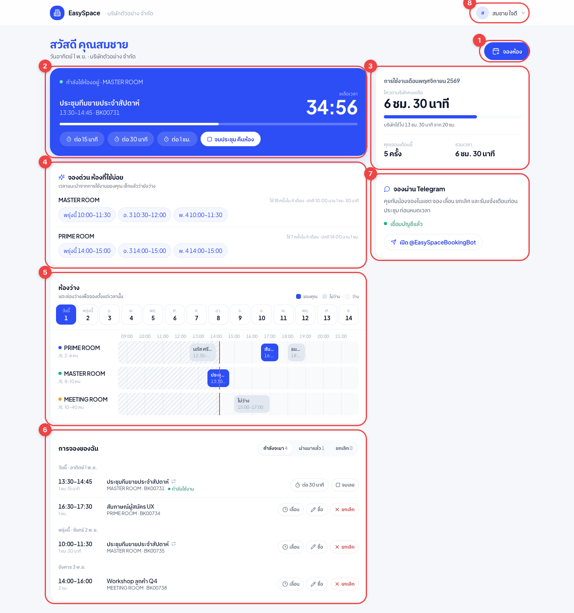

| # | ตรงไหน | ใช้ทำอะไร |
|---|---|---|
| 1 | ปุ่ม **จองห้อง** | เปิดหน้าต่างจอง เลือกห้อง วัน เวลา ชื่อ จองซ้ำทุกสัปดาห์ได้ |
| 2 | **กำลังใช้ห้องอยู่ / ประชุมถัดไป** | นับถอยหลังเวลาที่เหลือแบบวินาทีต่อวินาที ต่อเวลา 15 นาที / 30 นาที / 1 ชม. หรือจบประชุมคืนห้องได้ทันที ถ้ายังไม่ถึงเวลา จะบอกว่าอีกกี่นาทีเริ่ม พร้อมปุ่มเลื่อน/ยกเลิก |
| 3 | **การใช้งานเดือนนี้** | โควตาบริษัทที่เหลือเป็นชั่วโมง แถบใช้ไปแล้ว และที่คุณจองเดือนนี้ (กี่ครั้ง กี่ชั่วโมง) บริษัทที่ไม่จำกัดโควตาจะขึ้นว่า "ไม่จำกัดชั่วโมง" |
| 4 | **จองด่วน ห้องที่ใช้บ่อย** | ระบบดูว่าคุณใช้ห้องไหนบ่อย ปกติกี่โมง นานเท่าไร แล้วเสนอเวลาที่ยังว่างจริงใน 7 วันข้างหน้า กดเวลา พิมพ์ชื่อ แล้วกด "จองเลย" |
| 5 | **ห้องว่าง** | ตารางทุกห้องของวันที่เลือก (ดูล่วงหน้าได้ 14 วัน) แตะช่องว่างเพื่อจองตั้งแต่เวลานั้น เส้นแดงคือเวลาปัจจุบัน ช่องลายคือเวลาที่ผ่านไปแล้ว |
| 6 | **การจองของฉัน** | แยก กำลังจะมา / ผ่านมาแล้ว / ยกเลิก แต่ละรายการ เลื่อน เปลี่ยนชื่อ ยกเลิกได้ ถ้ากำลังใช้งานอยู่จะมีปุ่มต่อเวลาและจบเลย |
| 7 | **จองผ่าน Telegram** | ลิงก์ไปบอท และบอกว่าเชื่อมบัญชีแล้วหรือยัง |
| 8 | เมนูบัญชี | ไปบอท Telegram, จัดการสมาชิกบริษัท (เฉพาะผู้จัดการ), ออกจากระบบ |

**เวลาแนะนำมาจากไหน:** ระบบอ่านการจองของคุณย้อนหลัง 4 เดือน หาห้องที่ใช้บ่อย 3 ห้อง เวลาเริ่มและความยาวที่ใช้บ่อยที่สุด แล้วหาช่องที่ว่างจริงใกล้เวลานั้น (คลาดได้ไม่เกิน 2 ชั่วโมง) เป็นการคำนวณจากประวัติ ไม่ได้เรียก AI จึงเร็วและไม่เสียโควตา คนที่ยังไม่มีประวัติจะได้ช่วงเช้า 1 ชั่วโมง

### ตอนยังไม่ถึงเวลาประชุม

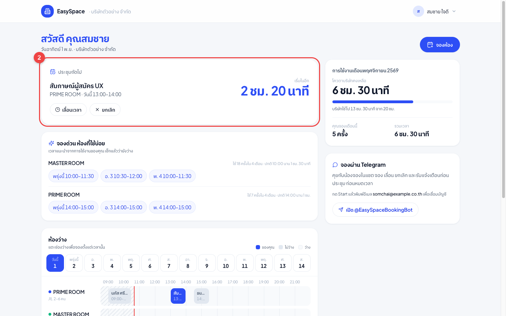

การ์ดข้อ 2 จะบอกประชุมถัดไปและนับถอยหลังว่าอีกนานเท่าไรถึงเวลาเริ่ม พร้อมปุ่มเลื่อนเวลาและยกเลิก

### จองด่วนจากเวลาแนะนำ

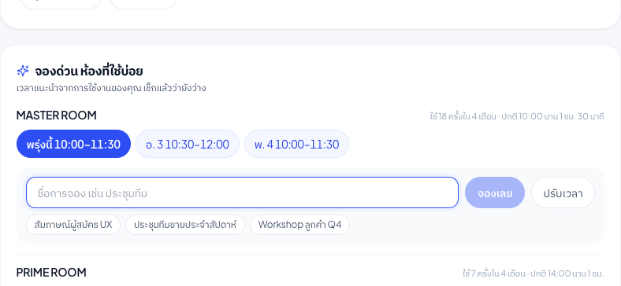

กดเวลาที่แนะนำ แล้วจะมีช่องชื่อการจองขึ้นมา พร้อมชื่อที่เคยใช้ให้กดเลือก กด **จองเลย** จบ หรือกด **ปรับเวลา** เพื่อเปิดหน้าต่างจองเต็ม

### หน้าต่างจอง

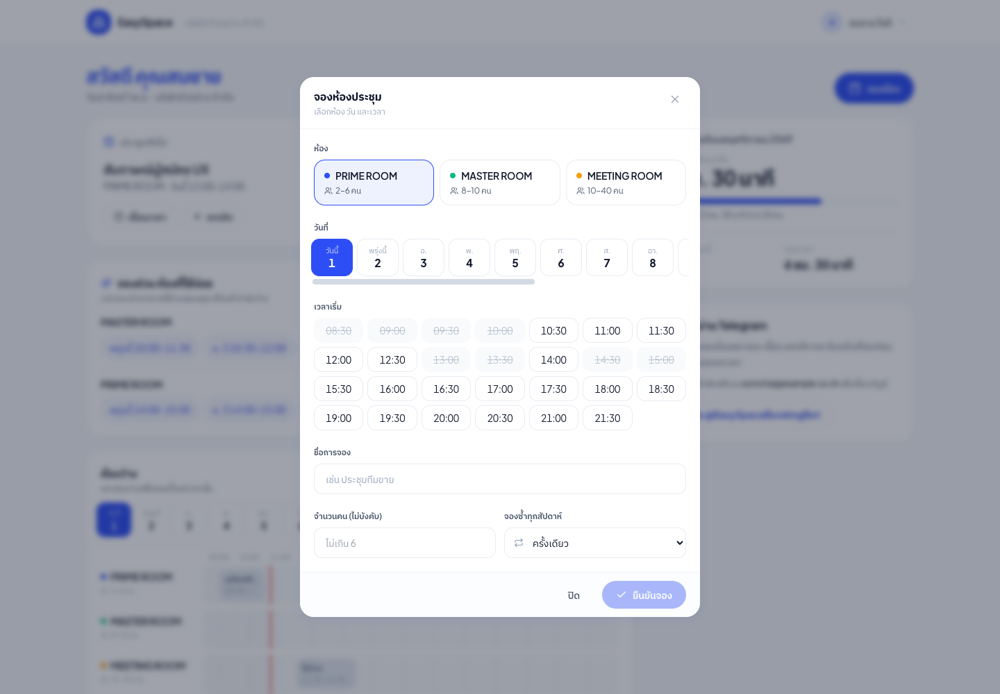

- ห้องที่ไม่เปิดวันนั้นกดไม่ได้
- เวลาที่ไม่ว่างหรือผ่านไปแล้วจะขีดฆ่า
- เลือกเวลาเริ่มแล้ว ระบบเสนอเวลาจบเฉพาะช่วงที่ว่างต่อเนื่อง
- บรรทัดล่างบอกโควตาบริษัทที่จะเหลือหลังจอง ถ้าเกินโควตาจะขึ้นสีแดงเตือน (ยังจองได้ เหมือนระบบเดิม)
- ใช้หน้าต่างเดียวกันตอนเลื่อนเวลา (ช่องชื่อกับจองซ้ำจะซ่อน)

### บนมือถือ

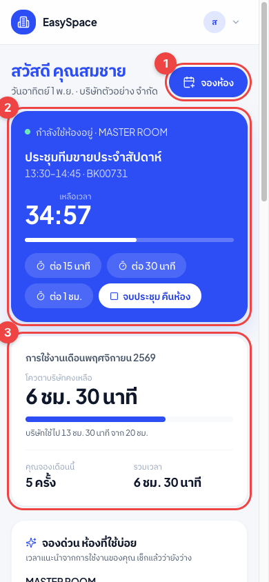

เรียงตามที่ใช้บ่อยที่สุด: ปุ่มจอง (1) การประชุมตอนนี้ (2) โควตา (3) แล้วตามด้วยจองด่วน ตารางห้องว่าง และรายการจอง ตารางห้องว่างเลื่อนซ้ายขวาได้ในกรอบ

### หน้าที่เอาออก

หน้าเหล่านี้ส่งต่อมาที่ `/app` อัตโนมัติ ลิงก์เก่าในอีเมลยังกดได้

`/app/calendar` · `/app/booking/new` · `/app/booking/[id]` · `/app/my-bookings` · `/app/notifications` · `/app/profile` · `/app/team`

### ไฟล์ที่เกี่ยวข้อง

| ไฟล์ | หน้าที่ |
|---|---|
| `src/app/app/page.tsx` | หน้าเดียวของผู้ใช้ภายใน |
| `src/app/app/_portal/portal-home.tsx` | การ์ดทั้งหมดในหน้า (ข้อ 2, 3, 4, 6, 7) |
| `src/app/app/_portal/availability.tsx` | ตารางห้องว่าง (ข้อ 5) |
| `src/app/app/_portal/booking-sheet.tsx` | หน้าต่างจอง / เลื่อน |
| `src/app/app/_components/shell.tsx` | แถบบนกับเมนูบัญชี (ข้อ 8) |
| `src/lib/actions/portal.ts` | คำสั่งจอง ยกเลิก เลื่อน ต่อเวลา จบเลย เปลี่ยนชื่อ อ่านตัวตนจาก session เท่านั้น |
| `src/lib/server/member-ops.ts` | กติกากลางที่เว็บและบอทใช้ร่วมกัน: เวลาเปิดจอง ช่องละ 30 นาที ห้ามจองย้อนหลัง จองล่วงหน้าไม่เกินที่ตั้งไว้ เช็กชน คำนวณโควตา เวลาแนะนำ |
| `src/lib/server/portal-data.ts` | รวมข้อมูลทั้งหน้าในครั้งเดียว |

---

## 3. บอท Telegram "น้องจอง" (@EasySpaceBookingBot)

ผู้ช่วยผู้หญิง พูด "หนู ค่ะ/นะคะ" ใช้ได้ทั้งกดปุ่มและพิมพ์

### 3.1 เชื่อมบัญชีด้วยอีเมล

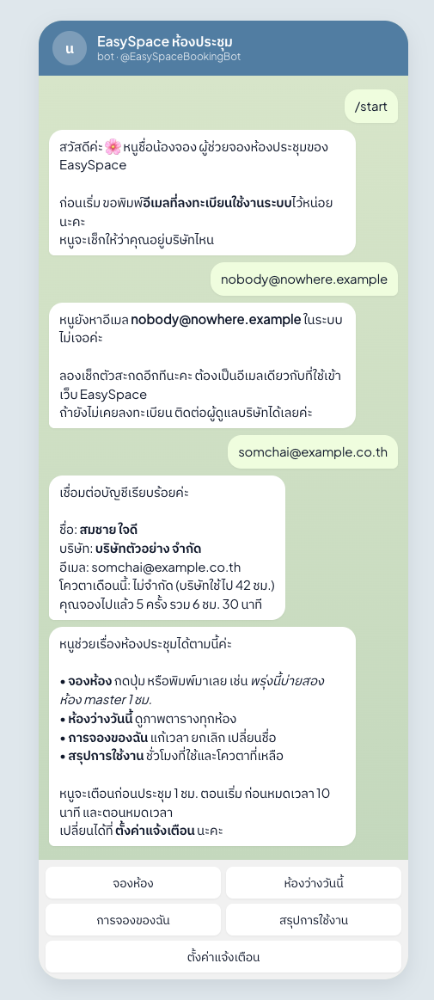

1. กด Start บอทแนะนำตัว แล้วขออีเมลที่ลงทะเบียนในระบบ
2. ถ้าอีเมลไม่มีในระบบ บอทบอกให้เช็กตัวสะกด
3. ถ้าตรง บอทขึ้นชื่อ บริษัท อีเมล โควตาเดือนนี้ และจำนวนที่จองไปแล้ว ตามด้วยวิธีใช้และเมนูด้านล่าง

ผูกด้วยอีเมลอย่างเดียวตามที่พี่ต้องการ ข้อควรรู้: ใครรู้อีเมลคนอื่นก็ผูกแทนได้ ผมจึงใส่กันไว้ 2 อย่าง คือพิมพ์ผิดได้ 6 ครั้งต่อ 30 นาที และถ้าบัญชีถูกผูกจากเครื่องใหม่ เครื่องเดิมจะได้ข้อความแจ้ง

### 3.2 จองด้วยปุ่ม

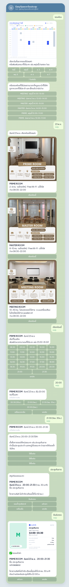

1. กด **จองห้อง** บอทส่ง**ภาพตาราง 7 วัน แยกห้องเหมือนปฏิทินในระบบ** พร้อมปุ่มเลือกวัน
2. บอทเสนอ**ห้องที่ใช้บ่อยพร้อมเวลาแนะนำ** กดทีเดียวไปขั้นตั้งชื่อได้เลย
3. เลือกวันแล้ว บอทส่ง**ภาพแต่ละห้อง ปุ่ม "เลือกห้องนี้" อยู่ใต้ภาพ** พร้อมช่วงที่ว่างวันนั้น
4. กดเวลาเริ่ม แล้วกดเวลาจบ (หรือพิมพ์ช่วงเวลาเองก็ได้ เช่น 13:00-15:00)
5. บอทขอชื่อการจอง และ**ถามแบบเนียน ๆ ในข้อความเดียวกันว่าถ้าเป็นประชุมประจำ บอกได้ว่าอยากจองซ้ำวันไหน** มีปุ่มชื่อที่เคยใช้ให้กด
6. การ์ดสรุปก่อนจอง มีปุ่ม ยืนยันจอง / จองซ้ำทุกสัปดาห์ / แก้เวลา / เปลี่ยนชื่อ / ยกเลิก
7. จองเสร็จได้**ภาพสรุป**พร้อมข้อความ: ห้อง วัน เวลา รหัส โควตาที่เหลือ ห้องว่างต่อได้ถึงกี่โมง และปุ่มแก้เวลา/ยกเลิก

ภาพที่บอทส่ง (วาดใหม่ทุกครั้งจากข้อมูลจริง)

| ตาราง 7 วัน | ห้องว่างวันนี้ |
|---|---|
| 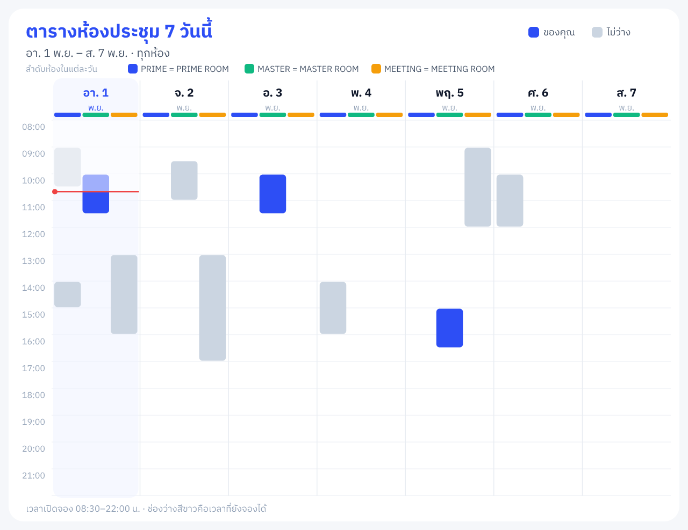 | 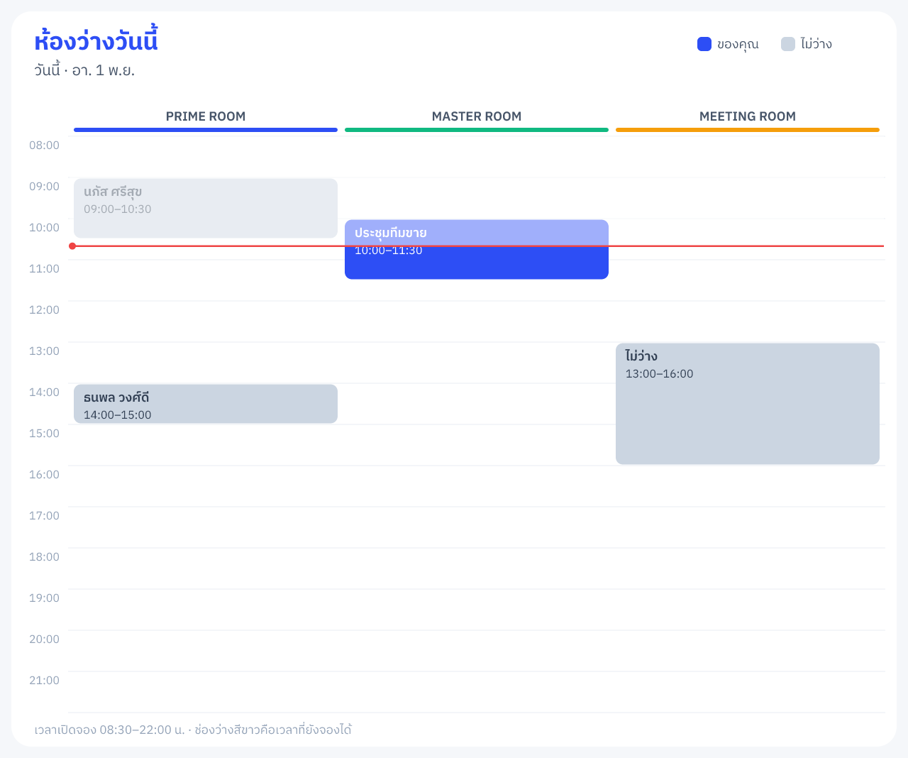 |

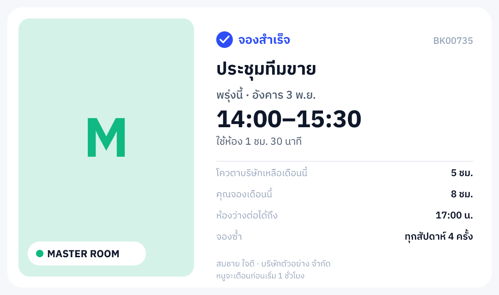

ในภาพตาราง สีน้ำเงินคือของคุณ สีเทาคือไม่ว่าง ภาพรายวันจะบอกชื่อเพื่อนร่วมบริษัทที่จองอยู่ ส่วนลูกค้าภายนอกและบริษัทอื่นขึ้นแค่ "ไม่ว่าง"

### 3.3 การจองของฉัน แก้เวลา ยกเลิก

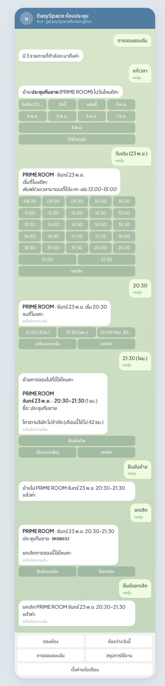

- **การจองของฉัน** แสดง 5 รายการถัดไป แต่ละรายการมีปุ่ม แก้เวลา / ยกเลิก / เปลี่ยนชื่อ
- แก้เวลา: เลือกวัน (มีปุ่ม "วันเดิม") แล้วเลือกเวลา ยืนยันอีกครั้งก่อนย้ายจริง
- ยกเลิก: ถามยืนยันก่อนทุกครั้ง
- การย้ายใช้ตัวตรวจเดียวกับเว็บ จึง**ไม่มีทางย้ายไปทับการจองของลูกค้า**

### 3.4 พิมพ์สั่งได้ (สมอง AI)

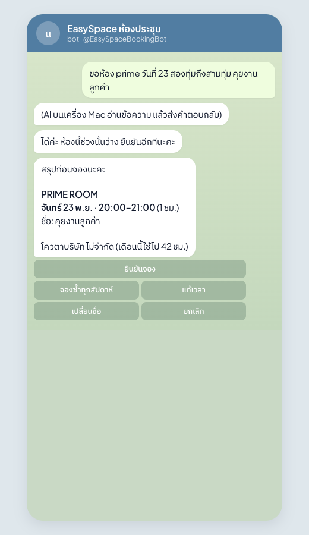

พิมพ์แบบคุยปกติได้ เช่น
- "พรุ่งนี้บ่ายสองขอห้อง master ชั่วโมงครึ่ง ประชุมทีมขาย ทุกสัปดาห์"
- "ห้องว่างวันศุกร์ไหม"
- "เลื่อนประชุมพรุ่งนี้ไปบ่ายสาม"
- "ยกเลิกอันวันพุธ"
- "เตือนก่อน 30 นาทีพอ"

บอทถามเฉพาะที่ขาด (วัน เวลา ชื่อ) ถ้าไม่บอกความยาว ใส่ 1 ชั่วโมงแล้วบอกให้รู้ **ทุกการจอง เลื่อน ยกเลิก ต้องกดยืนยันก่อนเสมอ** AI สั่งแก้ข้อมูลเองไม่ได้

ในภาพนี้ ขั้นตอบของ AI ถูกจำลองในการทดสอบอัตโนมัติ ส่วนประโยคเดียวกันผมลองกับ Claude บนเครื่องนี้แยกแล้ว ได้ผลตรงกัน (ห้อง PRIME วันที่ 23 เวลา 20:00–21:00 ชื่อ คุยงานลูกค้า) ใช้เวลาประมาณ 7 วินาที

อีกประโยคที่ลองจริง: "พรุ่งนี้บ่ายสองขอห้อง master ชั่วโมงครึ่ง ประชุมทีมขาย ทุกสัปดาห์" ได้พรุ่งนี้ 14:00–15:30 ห้อง MASTER ROOM ชื่อ ประชุมทีมขาย จองซ้ำ 4 สัปดาห์ ประมาณ 8 วินาที

### 3.5 แจ้งเตือน

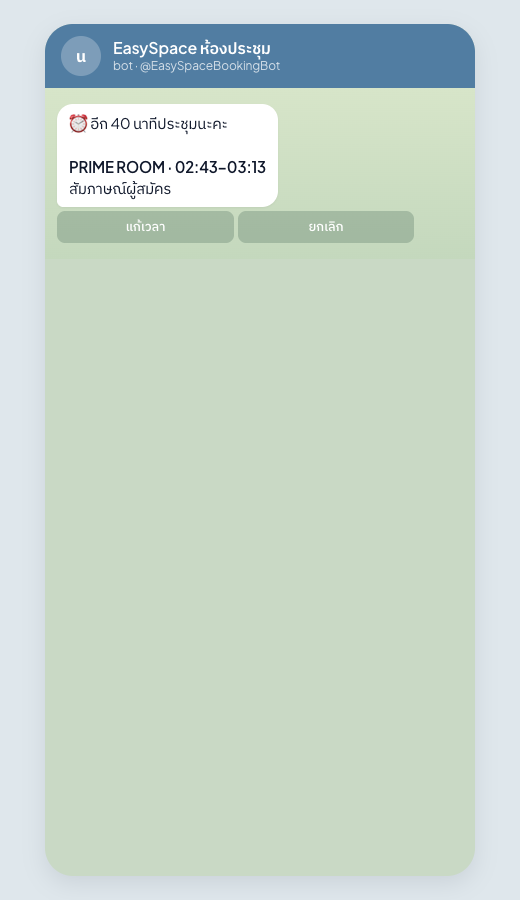

| เมื่อไร | ข้อความ | ปุ่ม |
|---|---|---|
| ก่อนเริ่ม (ค่าเริ่มต้น 1 ชั่วโมง) | ⏰ อีก 1 ชั่วโมงประชุมนะคะ + ห้อง เวลา ชื่อ | แก้เวลา · ยกเลิก |
| ถึงเวลาประชุม | ⏰ ถึงเวลาประชุมแล้วค่ะ | จบก่อนเวลา คืนห้อง |
| ก่อนหมดเวลา (ค่าเริ่มต้น 10 นาที) | อีก 10 นาทีหมดเวลาห้อง + ห้องว่างต่อได้ถึงกี่โมง | ต่อ 15 นาที / 30 นาที / 1 ชม. (เฉพาะที่ว่างพอ) · จบเลย |
| หมดเวลา | หมดเวลาห้องแล้วค่ะ ขอบคุณที่ใช้ห้องนะคะ | |
| ลูกค้าภายนอกจองห้อง (ยืนยันแล้ว) | มีการจองจากลูกค้าภายนอก + ห้อง วัน เวลา (ไม่บอกชื่อลูกค้า) ถ้าทับการจองของคุณจะบอกรหัสการจองที่โดนด้วย | |

ตามที่ตกลง **ไม่มีเตือนให้ Check-in**

### 3.6 ตั้งค่าแจ้งเตือนเอง

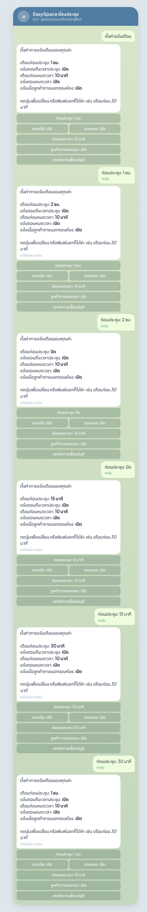

กด **ตั้งค่าแจ้งเตือน** แล้วกดปุ่มเพื่อเปลี่ยน หรือพิมพ์บอก เช่น "เตือนก่อน 30 นาที"
- เตือนก่อนประชุม: 15 นาที / 30 นาที / 1 ชม. / 2 ชม. / ปิด
- แจ้งตอนเริ่ม เปิด/ปิด, แจ้งตอนหมดเวลา เปิด/ปิด
- เตือนก่อนหมดเวลา: 5 / 10 / 15 นาที / ปิด
- แจ้งเมื่อลูกค้าภายนอกจองห้อง เปิด/ปิด
- ยกเลิกการเชื่อมบัญชี

### 3.7 ระบบทำงานอย่างไร

```
ผู้ใช้ Telegram
   │ กดปุ่ม / พิมพ์
   ▼
Vercel  /api/tgbot/webhook ─── ปุ่มทั้งหมด การผูกอีเมล การจอง ภาพตาราง ทำที่นี่ (ทำงานตลอด 24 ชม.)
   │  ข้อความที่พิมพ์อิสระ → เข้าคิว
   ▼
Mac เครื่องนี้  bot-worker/worker.mjs ── อ่านคิวทุก 1 วินาที → claude -p (บัญชี Claude ที่ล็อกอินบนเครื่อง)
   │  ได้ JSON: ข้อความตอบ + สิ่งที่ต้องทำ
   ▼
Vercel  /api/tgbot/worker/result ─── ส่งการ์ด ปุ่ม ภาพ ให้ผู้ใช้กดยืนยัน

แจ้งเตือน: /api/tgbot/tick  ← Mac เรียกทุก 1 นาที  และ GitHub Actions เรียกทุก 5 นาที (สำรอง)
```

- **ถ้าเครื่อง Mac ปิด:** ปุ่มทุกอย่างยังใช้ได้ แจ้งเตือนยังส่ง (ช้าลงเป็นรอบ 5 นาที) ส่วนข้อความที่พิมพ์ บอทจะตอบว่า "ตอนนี้อ่านข้อความพิมพ์ได้ช้าหน่อย ใช้ปุ่มได้เลย" ภายในไม่กี่นาที
- **สกิลที่ติดตั้งให้บอท** (`bot-worker/.claude/skills/`) โหลดเข้าทุกครั้งที่ตอบ
  - `nong-jong-voice` บุคลิกและวิธีตอบ (สั้น เว้นบรรทัด อิโมจิไม่เกิน 1 ตัว ถามจองซ้ำแบบเนียน ๆ)
  - `nong-jong-brain` วิธีคิด: แปลวันเวลาภาษาไทย (บ่ายสอง = 14:00 ทุ่ม = 19:00+) เลือกการกระทำเดียว ห้ามบอกว่าทำเสร็จก่อนผู้ใช้กดยืนยัน
  - `humanizer` ตัดสำนวนที่ฟังเหมือน AI (คัดลอกจากที่ติดตั้งไว้ในเครื่อง)
- **รุ่นที่ใช้:** Sonnet ระดับคิดต่ำ (เร็ว ประหยัดโควตา) เปลี่ยนได้ด้วยตัวแปร `TGBOT_MODEL` / `TGBOT_EFFORT` ในไฟล์ `.env.local`
- **ข้อมูลของบอท** (การผูกบัญชี ร่างการจอง คิวข้อความ) เก็บในตาราง `app_secrets` ที่อ่านได้เฉพาะฝั่งเซิร์ฟเวอร์ **ไม่ต้องรัน SQL เพิ่ม**

### 3.8 ไฟล์ของบอท

| ไฟล์ | หน้าที่ |
|---|---|
| `src/app/api/tgbot/webhook/route.ts` | รับข้อความจาก Telegram (เช็กรหัสลับทุกครั้ง) |
| `src/lib/tgbot/flows.ts` | ผูกอีเมล เมนู ปุ่มทั้งหมด จบการจอง |
| `src/lib/tgbot/views.ts` | ตัวเลือกวัน ห้อง เวลา การ์ดยืนยัน รายการจอง ตั้งค่า |
| `src/lib/tgbot/render.ts` | วาดภาพตาราง/ภาพสรุป (ฟอนต์ IBM Plex Sans Thai) |
| `src/lib/tgbot/ai.ts` | คิวข้อความไปให้ AI และทำตามคำตอบ (ผ่านปุ่มยืนยัน) |
| `src/lib/tgbot/notify.ts` | แจ้งเตือนตามเวลา และแจ้งเมื่อลูกค้าภายนอกจอง |
| `src/lib/tgbot/store.ts` | ที่เก็บข้อมูลของบอท |
| `src/lib/tgbot/telegram.ts` | เชื่อม Telegram API |
| `src/app/api/tgbot/tick/route.ts` | จุดเรียกแจ้งเตือน |
| `src/app/api/tgbot/worker/result/route.ts` | รับคำตอบจาก AI บน Mac |
| `src/app/api/cron/time-alerts/route.ts` | เพิ่มเรียกแจ้งเตือนของบอท (สำรองทุก 5 นาที) |
| `bot-worker/worker.mjs` | สมองบน Mac |
| `bot-worker/.claude/skills/*` | สกิลบุคลิก วิธีคิด humanizer |
| `bot-worker/install-launchd.sh` | ตั้งให้ worker รันตลอด |
| `scripts/tgbot/setup.ts` | ตั้ง webhook และเมนูบอท |
| `src/assets/fonts/*` | ฟอนต์ไทยสำหรับวาดภาพ |

---

## 4. การทดสอบ

| สิ่งที่ทดสอบ | ผล |
|---|---|
| `npm run test:tgbot` คุยกับบอทครบวงจรบนฐานข้อมูลจริง (ไม่ส่ง Telegram จริง ไม่ส่งอีเมล) | ผ่าน 28/28: ผูกอีเมลถูก/ผิด, จองด้วยปุ่มถึงภาพสรุป, กดยืนยันซ้ำไม่จองซ้ำ, เลื่อน, ยกเลิก, ตั้งค่า, ข้อความพิมพ์เข้าคิว AI แล้วจบที่การ์ดยืนยัน, AI จองเองไม่ได้, เตือนก่อนประชุมพร้อมปุ่ม, ไม่เตือนซ้ำ, ยกเลิกการเชื่อม ข้อมูลทดสอบถูกลบหลังจบ |
| Claude บน Mac กับประโยคไทยจริง | แปลวัน เวลา ห้อง ชื่อ และจองซ้ำถูก ประมาณ 8 วินาที |
| `next build` และ deploy ขึ้น Vercel | ผ่าน |
| หน้าเว็บใหม่บนคอมและมือถือ (หน้าตัวอย่าง `/dev/portal` เปิดได้เฉพาะเครื่องนักพัฒนา) | แสดงครบ ไม่ล้นจอมือถือ หน้าต่างจองเปิดจากปุ่มและจากการแตะตาราง |
| หน้า `/app` บน production ตอนยังไม่ Login | ส่งไปหน้า Login สมาชิกถูกต้อง |

**ยังไม่ได้ทดสอบ**
- Login Google จริงด้วยบัญชีจริง (ต้องใช้บัญชีของพี่) แนะนำให้ลองออกจากระบบแล้วเข้าใหม่ 1 รอบ และลองเปิดค้างไว้เกิน 1 ชั่วโมงแล้วกดต่อ
- บอทกับ Telegram จริง รอทำ 3 ขั้นด้านบนก่อน
- จองจริงผ่านหน้าเว็บใหม่ด้วยบัญชีจริง

---

## 5. ข้อควรรู้

- **ค่าตั้งการเลื่อนเวลา:** ค่าเริ่มต้น "ต้องเลื่อนก่อนเริ่มกี่ชั่วโมง" เปลี่ยนจาก 2 เป็น 0 เพื่อให้ปุ่มแก้เวลาในข้อความเตือน 1 ชั่วโมงก่อนประชุมใช้ได้ ถ้าตั้งเพิ่มในหลังบ้าน (ตั้งค่า → ผู้ใช้ภายในเลื่อนเวลาเอง) ปุ่มนั้นจะเลื่อนไม่ได้
- **โควตา:** ระบบเตือนเมื่อเกินโควตาแต่ยังให้จอง เหมือนเดิม ถ้าอยากให้บล็อก บอกผมได้
- **ตัวนับโควตาบริษัท:** เดิมนับการจองที่ยกเลิกแล้วด้วย และเริ่มเดือนตามเวลา UTC แก้ให้ไม่นับที่ยกเลิก/ไม่มาใช้ และนับเดือนตามเวลาไทย ตัวเลขโควตาจึงอาจลดลงจากเดิม
- **ต่อเวลา / จบก่อนเวลา** ไม่ได้แก้ event ใน Google Calendar ที่ระบบสร้างไว้ (เวลาใน Calendar จะเป็นเวลาเดิม)
- **ข้อมูลห้อง:** ห้อง PRIME ROOM เก็บวันอาทิตย์เป็นเลข 7 (ห้องอื่นใช้ 0) ระบบใหม่อ่านได้ทั้งสองแบบ
- **ไฟล์หน้าเก่า** (`member-calendar-board.tsx`, `booking-shell.tsx`, `reschedule-panel.tsx` ฯลฯ) ยังอยู่ในโฟลเดอร์แต่ไม่มีหน้าไหนใช้แล้ว ผมลบเองไม่ได้เพราะระบบสิทธิ์บล็อกการลบไฟล์ ลบทิ้งได้เลยเมื่อสะดวก
- **ภาพในคู่มือ** สร้างใหม่ได้ด้วย `npm run manual:images` (ต้องเปิด dev server พอร์ต 3107 และรัน `npm run test:tgbot` ก่อน)
