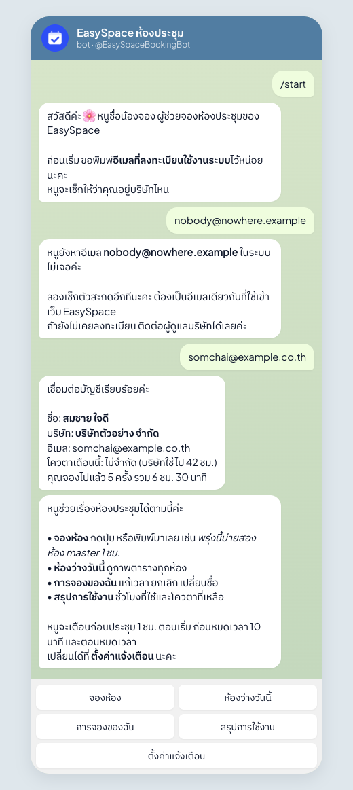
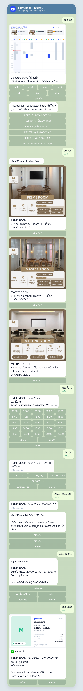
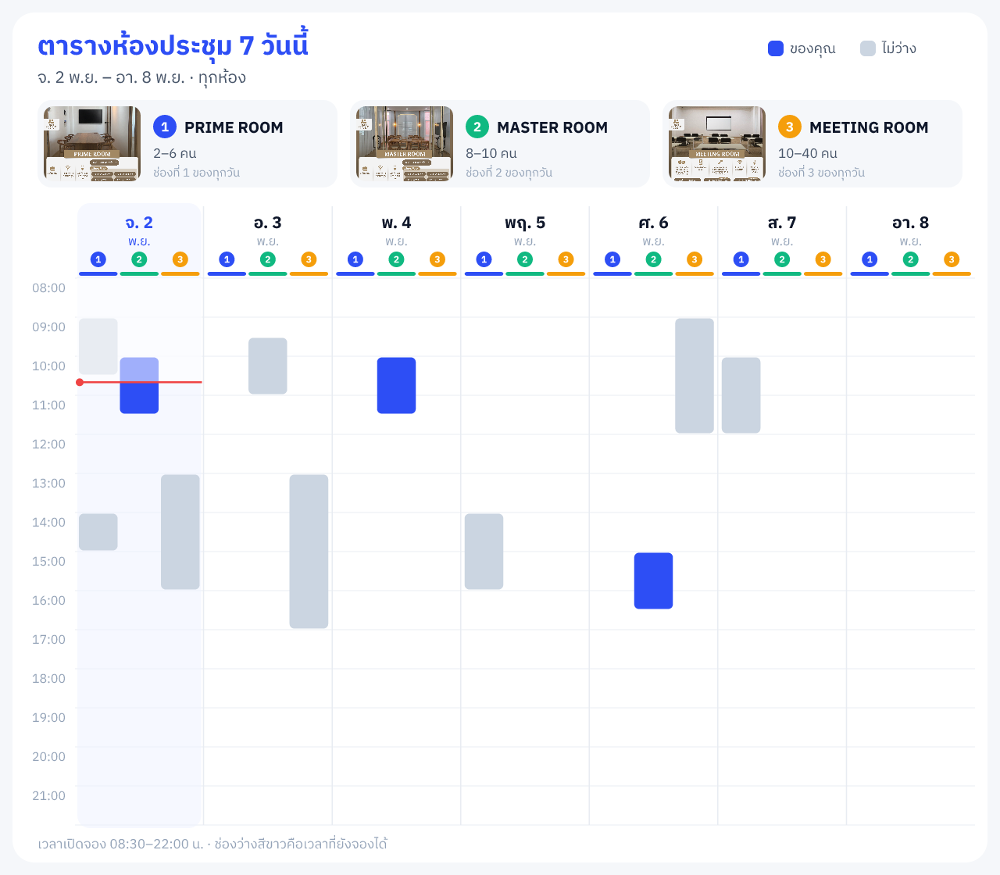
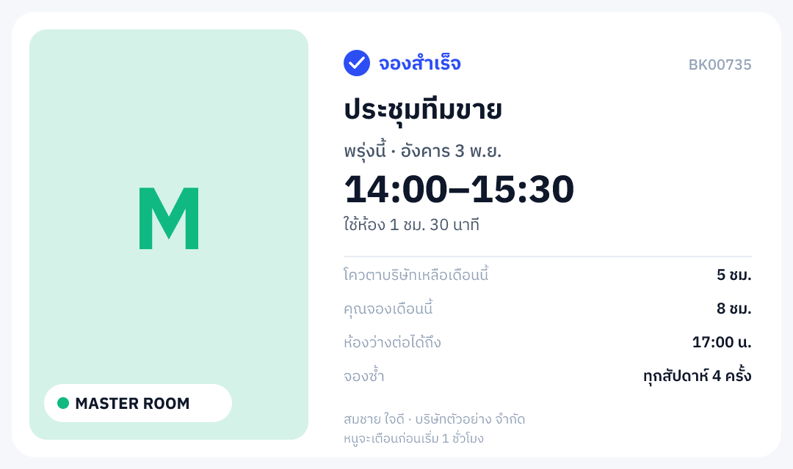
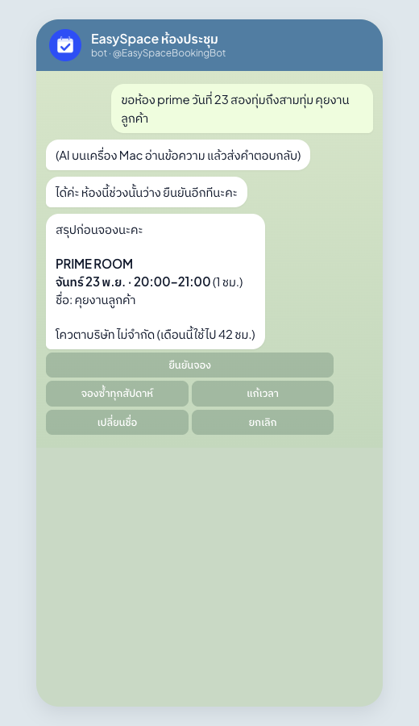
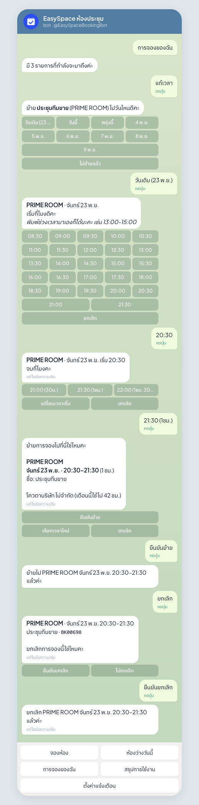
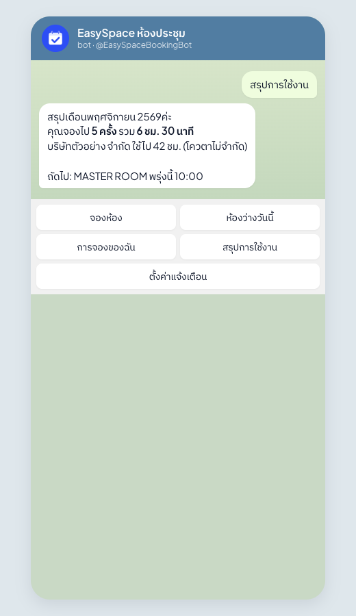
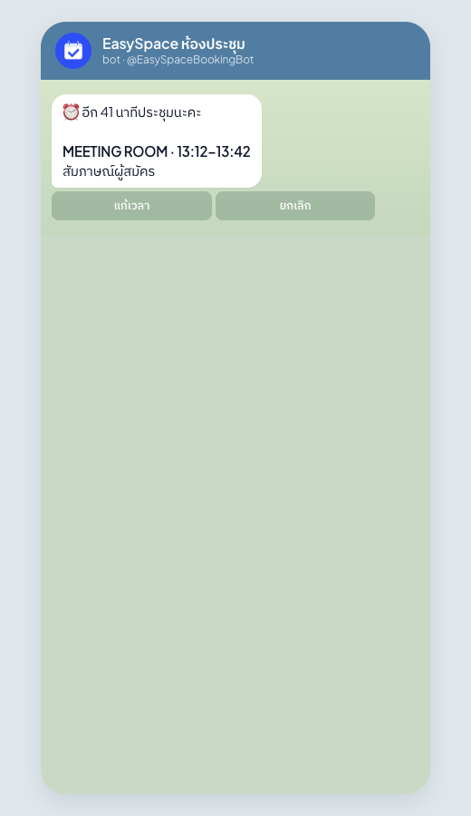
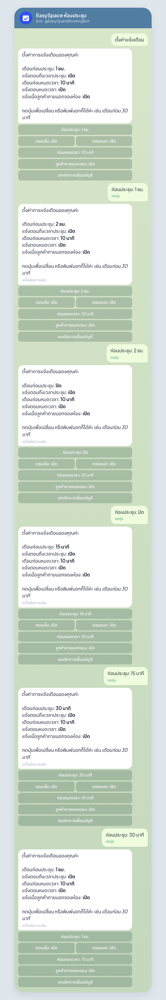

# คู่มือพนักงาน: จองห้องผ่าน Telegram กับ "น้องจอง"

น้องจองคือผู้ช่วยจองห้องประชุมใน Telegram จอง ดูห้องว่าง เลื่อน ยกเลิก และเตือนก่อนประชุมได้ในแชตเดียว

Telegram: **@EasySpaceBookingBot** · ลิงก์ https://t.me/EasySpaceBookingBot

> ภาพในคู่มือใช้ข้อมูลตัวอย่าง ข้อความของบอทเป็นข้อความจริงที่ระบบตอบ

---

## 1. เริ่มใช้ครั้งแรก (เชื่อมบัญชี)

1. เปิด Telegram ค้นหา **@EasySpaceBookingBot** แล้วกด **Start**
2. พิมพ์**อีเมลที่ลงทะเบียนใช้งานระบบ** (อีเมลเดียวกับที่ login เว็บ)
3. ถ้าถูกต้อง บอทจะขึ้นชื่อ บริษัท อีเมล และโควตาเดือนนี้ แล้วเมนูจะขึ้นด้านล่าง

ถ้าขึ้นว่า "หาอีเมลไม่เจอ" ให้เช็กตัวสะกด หรือขอให้ผู้ดูแลบริษัทเพิ่มคุณในระบบก่อน

**เมนูด้านล่าง**

| ปุ่ม | ทำอะไร |
|---|---|
| จองห้อง | เริ่มจอง (ข้อ 2) |
| ห้องว่างวันนี้ | ภาพตารางทุกห้องของวันนี้ พร้อมปุ่มจองช่วงที่ว่าง |
| การจองของฉัน | รายการที่กำลังจะมา แก้เวลา ยกเลิก เปลี่ยนชื่อ |
| สรุปการใช้งาน | ชั่วโมงที่จองเดือนนี้ และโควตาที่เหลือ |
| ตั้งค่าแจ้งเตือน | เลือกว่าจะให้เตือนตอนไหน |

---

## 2. จองด้วยปุ่ม (ไม่กี่ขั้น)

1. กด **จองห้อง** บอทส่งภาพตาราง 7 วันของทุกห้อง

   

   ด้านบนมีรูปห้องพร้อมเลข 1, 2, 3 ใต้แต่ละวันมีช่องเลข 1, 2, 3 ตรงกับห้อง **สีน้ำเงิน**คือของคุณ **สีเทา**คือไม่ว่าง ช่องขาวคือว่าง
2. บอทเสนอ**ห้องที่คุณใช้บ่อยพร้อมเวลาที่ยังว่าง** กดทีเดียวข้ามไปขั้นตั้งชื่อได้เลย
3. หรือกดเลือกวัน แล้วบอทส่งรูปแต่ละห้อง กด **เลือกห้องนี้** ใต้รูปห้องที่ต้องการ
4. กดเวลาเริ่ม แล้วกดเวลาจบ (พิมพ์ช่วงเวลาเองก็ได้ เช่น `13:00-15:00`)
5. พิมพ์ชื่อการจอง หรือกดชื่อที่เคยใช้ ถ้าเป็นประชุมประจำ บอกน้องจองได้เลยว่าอยากจองซ้ำ
6. ดูการ์ดสรุป แล้วกด **ยืนยันจอง** หรือกด **จองซ้ำทุกสัปดาห์** (4 / 8 / 12 สัปดาห์), **แก้เวลา**, **เปลี่ยนชื่อ** ก่อนก็ได้
7. จองเสร็จได้ภาพสรุป

   

   บอกห้อง วัน เวลา รหัสการจอง โควตาที่เหลือ และห้องว่างต่อได้ถึงกี่โมง (ถ้าอยากต่อเวลา)

---

## 3. พิมพ์สั่งได้เหมือนคุยกับคน

ตัวอย่างที่พิมพ์ได้

| อยากทำ | พิมพ์ |
|---|---|
| จอง | พรุ่งนี้บ่ายสองขอห้อง master ชั่วโมงครึ่ง ประชุมทีมขาย |
| จองประจำ | ทุกวันจันทร์ 10 โมง ห้อง prime 1 ชม. daily stand-up |
| ดูห้องว่าง | ห้องว่างวันศุกร์ไหม |
| เลื่อน | เลื่อนประชุมพรุ่งนี้ไปบ่ายสาม |
| ยกเลิก | ยกเลิกอันวันพุธ |
| เปลี่ยนชื่อ | เปลี่ยนชื่อประชุมพรุ่งนี้เป็น รีวิวงานลูกค้า |
| ต่อเวลา | ขอต่ออีก 30 นาที |
| ตั้งค่า | เตือนก่อน 30 นาทีพอ |

- น้องจองถามเฉพาะที่ยังขาด (วัน เวลา ชื่อ) ถ้าไม่บอกว่านานเท่าไร จะใส่ 1 ชั่วโมงและบอกให้รู้
- **ทุกการจอง เลื่อน ยกเลิก ต้องกดยืนยันก่อนเสมอ** พิมพ์ผิดไม่มีทางจองหรือยกเลิกเอง
- ตอบช้ากว่าปุ่มเล็กน้อย (ประมาณ 10 วินาที) ถ้ารีบใช้ปุ่มเร็วกว่า

---

## 4. การจองของฉัน: แก้เวลา ยกเลิก

- กด **การจองของฉัน** บอทส่งรายการที่กำลังจะมา (5 รายการแรก)
- **แก้เวลา**: เลือกวัน (มีปุ่ม "วันเดิม") แล้วเลือกเวลาเริ่ม เวลาจบ แล้วกด **ยืนยันย้าย**
- **ยกเลิก**: กด **ยืนยันยกเลิก** อีกครั้ง
- **เปลี่ยนชื่อ**: พิมพ์ชื่อใหม่

## 5. สรุปการใช้งาน

บอกจำนวนครั้งและชั่วโมงที่คุณจองเดือนนี้ ชั่วโมงที่บริษัทใช้ไป และโควตาที่เหลือ

---

## 6. การแจ้งเตือน

| เมื่อไร | ปุ่มที่กดได้ |
|---|---|
| ก่อนประชุม (เริ่มต้น 1 ชั่วโมง) | แก้เวลา · ยกเลิก |
| ถึงเวลาประชุม | จบก่อนเวลา คืนห้อง |
| ก่อนหมดเวลา (เริ่มต้น 10 นาที) | ต่อ 15 นาที / 30 นาที / 1 ชม. (เฉพาะที่ห้องยังว่าง) · จบเลย |
| หมดเวลา | |
| ลูกค้าภายนอกจองห้อง | ไม่มีปุ่ม ถ้าทับการจองของคุณ บอทจะบอกรหัสการจองที่โดน |

### ตั้งค่าเอง

กด **ตั้งค่าแจ้งเตือน** แล้วกดปุ่มเพื่อสลับค่า
- เตือนก่อนประชุม: 15 นาที / 30 นาที / 1 ชม. / 2 ชม. / ปิด
- แจ้งตอนเริ่ม, แจ้งตอนหมด: เปิด / ปิด
- เตือนก่อนหมดเวลา: 5 / 10 / 15 นาที / ปิด
- แจ้งเมื่อลูกค้าภายนอกจองห้อง: เปิด / ปิด
- **ยกเลิกการเชื่อมบัญชี** หยุดแจ้งเตือนทั้งหมด

---

## 7. คำถามที่พบบ่อย

**พิมพ์ไปแล้วบอทบอกว่า "ตอนนี้อ่านข้อความพิมพ์ได้ช้าหน่อย"**
ระบบอ่านข้อความพิมพ์ปิดอยู่ชั่วคราว ใช้ปุ่มจอง ดูห้องว่าง และดูการจองได้ตามปกติ

**เปลี่ยนเครื่อง หรือ Telegram ใหม่**
กด Start แล้วพิมพ์อีเมลอีกครั้ง เครื่องเดิมจะได้ข้อความว่าบัญชีย้ายไปเครื่องใหม่

**จองในบอทแล้วเห็นในเว็บไหม**
เห็น เป็นระบบเดียวกัน จองหรือยกเลิกที่ไหนก็อัปเดตทั้งสองที่
