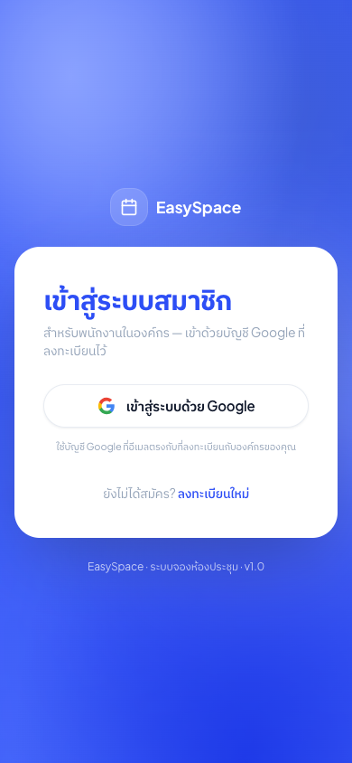
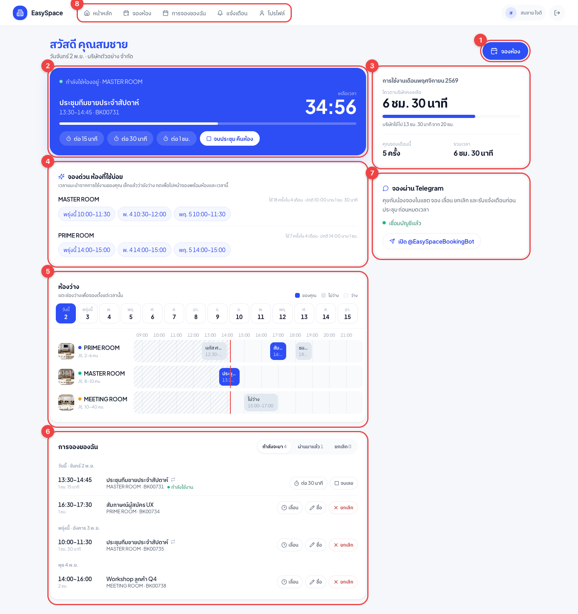
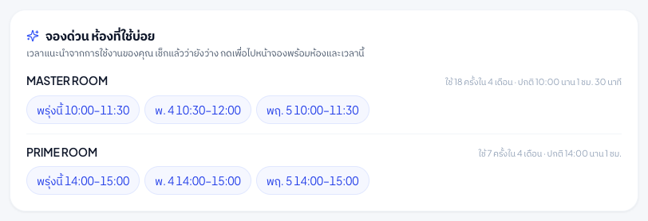
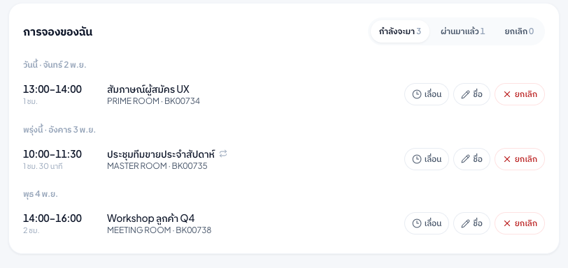
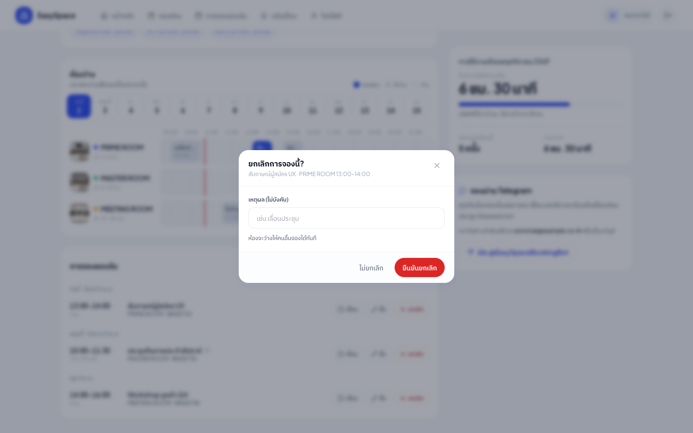
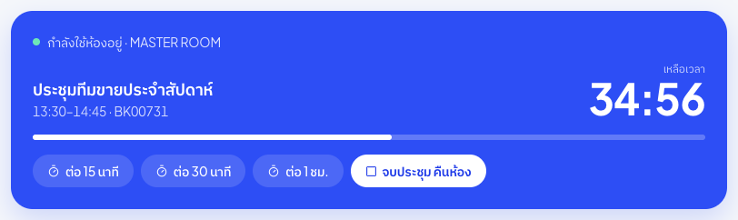
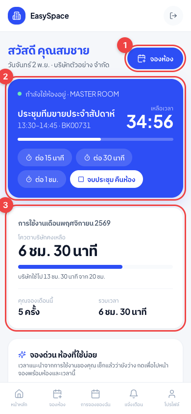

# คู่มือพนักงาน: จองห้องประชุมผ่านเว็บ EasySpace

สำหรับพนักงานบริษัทในตึกที่ใช้ห้องประชุม PRIME, MASTER และ MEETING ROOM

เว็บไซต์: **https://easy-space-meeting-room-yjqk.vercel.app**

> ภาพในคู่มือใช้ข้อมูลตัวอย่าง ชื่อคนและชื่อประชุมเป็นชื่อสมมติ

---

## 1. เข้าสู่ระบบ

1. เปิดเว็บไซต์ แล้วกด **เข้าสู่ระบบด้วย Google**
2. เลือกบัญชี Google ที่อีเมลตรงกับที่ลงทะเบียนกับบริษัท
3. ระบบพาเข้าหน้าหลักทันที

**ครั้งแรก** ต้องสมัครผ่านลิงก์เชิญที่ผู้ดูแลบริษัทส่งให้ก่อน ถ้าขึ้นว่า "อีเมลยังไม่ถูกลงทะเบียน" ให้ขอลิงก์เชิญจากผู้ดูแลบริษัท

---

## 2. หน้าหลัก

เปิดมาจะเห็นทุกอย่างที่ต้องใช้ในหน้าเดียว

| # | ส่วน | ใช้ทำอะไร |
|---|---|---|
| 1 | ปุ่ม **จองห้อง** | ไปหน้าจองห้อง (ข้อ 3) |
| 2 | **การประชุมตอนนี้ / ถัดไป** | นับถอยหลังเวลาที่เหลือ กดต่อเวลาหรือจบประชุมได้ ถ้ายังไม่เริ่มจะบอกว่าอีกนานเท่าไรถึงเวลา |
| 3 | **การใช้งานเดือนนี้** | โควตาชั่วโมงของบริษัทที่เหลือ และที่คุณจองไปเดือนนี้ |
| 4 | **จองด่วน ห้องที่ใช้บ่อย** | เวลาที่ระบบแนะนำจากที่คุณใช้ประจำ และยังว่างจริง กดแล้วไปหน้าจองพร้อมห้องและเวลานั้น |
| 5 | **ห้องว่าง** | ตารางทุกห้องของวันที่เลือก แตะช่องว่างเพื่อไปจองเวลานั้น |
| 6 | **การจองของฉัน** | รายการที่กำลังจะมา ผ่านมาแล้ว และที่ยกเลิก พร้อมปุ่มจัดการ |
| 7 | **จองผ่าน Telegram** | ลิงก์ไปบอทน้องจอง ดูคู่มือ [staff-telegram.md](staff-telegram.md) |
| 8 | เมนูด้านบน | หน้าหลัก · จองห้อง (ปฏิทิน) · การจองของฉัน · แจ้งเตือน · โปรไฟล์ |

### อ่านตารางห้องว่าง (ข้อ 5)

- เลือกวันจากแถบวันที่ (ดูล่วงหน้าได้ 14 วัน)
- **สีน้ำเงิน** คือการจองของคุณ **สีเทา** คือไม่ว่าง ช่องที่ไม่มีอะไรคือว่าง
- เส้นแดงคือเวลาตอนนี้ ช่องลายคือเวลาที่ผ่านไปแล้ว
- ถ้าเป็นเพื่อนร่วมบริษัทจอง จะเห็นชื่อ ถ้าเป็นลูกค้าภายนอกหรือบริษัทอื่น จะเห็นแค่ "ไม่ว่าง"
- บนมือถือ เลื่อนตารางซ้ายขวาได้

### จองด่วนจากเวลาแนะนำ (ข้อ 4)

ระบบดูประวัติการจองของคุณ 4 เดือนย้อนหลังว่าใช้ห้องไหนบ่อย ปกติกี่โมง นานเท่าไร แล้วหาช่วงที่ยังว่างใกล้เวลานั้นใน 7 วันข้างหน้า กดเวลาที่ต้องการ แล้วระบบพาไปหน้าจองพร้อมเลือกห้อง วัน และเวลาเริ่มไว้ให้ คนที่ยังไม่เคยจองจะได้ช่วงเช้า 1 ชั่วโมง

---

## 3. จองห้อง

เข้าหน้าจองได้ 4 ทาง: ปุ่ม **จองห้อง** บนหน้าหลัก, เมนู **จองห้อง** ด้านบน (ปฏิทิน), กด **เวลาแนะนำ** หรือ **แตะช่องว่าง** ในตารางห้องว่าง (สองทางหลังเลือกห้องกับเวลาไว้ให้แล้ว)

ขั้นตอนในหน้าจอง

1. **เลือกห้อง** ดูความจุที่การ์ดห้อง
2. **วัน & เวลา**
   - เลือกวันที่ และใส่จำนวนคน
   - **ช่วงเวลา** แบ่งเป็นรอบเช้า รอบบ่าย และรอบพิเศษ (17:00–22:00) แต่ละช่อง = 30 นาที
   - คลิกหลายช่องต่อกันเพื่อเลือกเป็นช่วง เช่น คลิก 11:00 กับ 11:30 = จอง 11:00–12:00
   - ช่องสีแดงคือมีคนจองแล้ว เลือกไม่ได้
3. **จองซ้ำ** (ถ้าเป็นประชุมประจำ) เลือก รายวัน · รายสัปดาห์ · ทุกวันธรรมดา (จันทร์–ศุกร์) · รายเดือน ฯลฯ แล้วใส่ **จำนวนครั้งที่จอง** ระบบแสดงตัวอย่างวันที่ให้ดูก่อน ครั้งที่ชนกับคนอื่นจะถูกข้าม
4. **รายละเอียดประชุม**
   - **หัวข้อประชุม** (ต้องใส่) เช่น Sprint Planning
   - Agenda และหมายเหตุภายใน (ไม่บังคับ)
   - **ให้เพื่อนในองค์กรเห็นหัวข้อ** เปิดไว้ เพื่อนร่วมบริษัทจะเห็นชื่อและหัวข้อ ปิดไว้ จะเห็นแค่ชื่อคุณ
5. กด **ยืนยันการจอง**

จองเสร็จ ระบบส่งอีเมลยืนยัน และถ้าเชื่อม Telegram ไว้ น้องจองจะเตือนก่อนประชุมให้

---

## 4. จัดการการจองของฉัน

ที่หน้าหลัก (ข้อ 6) หรือเมนู **การจองของฉัน**

| ปุ่ม | ทำอะไร |
|---|---|
| **เลื่อน** | ไปหน้ารายละเอียดการจอง แล้วกด **เลื่อนวัน/เวลา** เลือกวัน เวลาเริ่ม ระยะเวลา (ย้ายห้องได้ถ้าผู้ดูแลอนุญาต) กด **ตรวจสอบเวลาว่าง** แล้ว **ยืนยัน** ถ้าเป็นการจองซ้ำ เลือกได้ว่าจะย้ายครั้งนี้ ครั้งนี้และต่อไป หรือทั้งชุด |
| **ชื่อ** | เปลี่ยนชื่อการจอง |
| **ยกเลิก** | ถามยืนยันก่อน ใส่เหตุผลได้ ห้องจะว่างให้คนอื่นจองทันที |
| **ต่อ 30 นาที** | ขึ้นเฉพาะตอนกำลังประชุม ต่อได้ถ้าช่วงถัดไปว่าง |
| **จบเลย** | ขึ้นเฉพาะตอนกำลังประชุม จบก่อนเวลาและคืนห้องที่เหลือ |

### ยกเลิกการจอง

### ระหว่างประชุม

การ์ดสีน้ำเงินนับถอยหลังเวลาที่เหลือ
- **ต่อ 15 นาที / 30 นาที / 1 ชม.** ต่อได้ถ้าไม่มีคนจองต่อ ถ้ามีคนจองแล้วระบบจะบอกว่าต่อไม่ได้
- **จบประชุม คืนห้อง** ประชุมเสร็จก่อน กดเพื่อให้คนอื่นใช้ห้องต่อได้

---

## 5. บนมือถือ

ใช้ได้ทุกอย่างเหมือนบนคอม เมนูอยู่ด้านล่างจอ ตารางห้องว่างเลื่อนซ้ายขวาได้

---

## 6. คำถามที่พบบ่อย

**โควตาหมดแล้วจองได้ไหม**
ระบบยังให้จอง แต่ผู้ดูแลจะเห็นว่าบริษัทใช้เกินโควตา

**ทำไมเห็นห้องว่าง แต่จองไม่ได้**
อาจมีคนจองช่วงนั้นไปก่อนระหว่างที่คุณเปิดหน้าค้างไว้ รีเฟรชหน้าแล้วลองใหม่ หน้าหลักอัปเดตเองทุก 1 นาที

**ย้ายการจองไปทับลูกค้าภายนอกได้ไหม**
ไม่ได้ ระบบกันไว้ทุกกรณี

**ถูก login ออกบ่อย**
แก้แล้วในรอบนี้ ถ้ายังเจอ แจ้งผู้ดูแลระบบพร้อมเวลาที่เกิด
